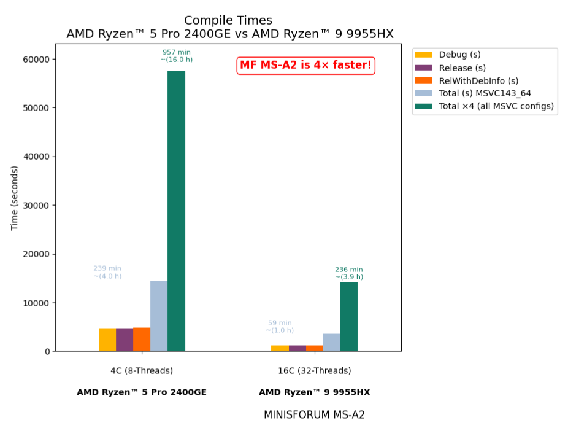

# Sponsorship

This project is proudly supported by [Minisforum](https://www.minisforum.com/products/minisforum-ms-a2), who generously provided the **MS-A2 workstation** - the powerhouse behind our CI/CD pipeline.
Powered by the **AMD Ryzen™ 9 9955HX (16C/32T)**, the MS-A2 has completely transformed the build infrastructure and release velocity.

## Real-World Build Performance Gains

Upgrading from the previous CI machine (Ryzen™ 5 2400GE) to the MS-A2 delivered massive performance improvements across all configurations:

{ width="75%" }

| System                        | Debug      | Release    | RelWithDebInfo | Total (3 configs) | Total ×4 platforms |
| ----------------------------- | ---------- | ---------- | -------------- | ----------------- | ------------------ |
| Ryzen™ 5 2400GE (4C/8T)       | 1.30 h     | 1.33 h     | 1.36 h         | 3.99 h            | 15.95 h            |
| **Ryzen™ 9 9955HX (16C/32T)** | **0.33 h** | **0.32 h** | **0.33 h**     | **0.98 h**        | **3.94 h**         |

## What That Means

- **75% reduction** in compile time per configuration
- **Full CI runs reduced from ~17 hours to ~4.3 hours**
- **4× faster complete multi-platform builds**
- Faster iteration cycles
- More frequent releases
- Quicker contributor feedback

For a C++ project building across multiple **Visual Studio toolsets (MSVC142, MSVC143, MSVC145)** and architectures (x86, x64), parallelism matters - and 16 cores / 32 threads make a *huge* difference.

## Why This Matters

Faster CI means:

- Pull requests get validated sooner
- Bugs are caught earlier
- Releases ship faster
- The Windows C++ community gets updated prebuilt binaries more quickly

The MS-A2 enables us to build complex C++ stacks like gRPC efficiently across multiple compiler targets - something that previously required nearly a full day of CI (waiting) time.

## Thank You

A huge thank you to **Minisforum** for supporting open-source development and helping us improve reliability and delivery speed for our users.

If you're looking for a compact yet extremely capable build workstation, the MS-A2 is absolutely worth checking out.

:material-arrow-right: [https://www.minisforum.com/products/minisforum-ms-a2](https://www.minisforum.com/products/minisforum-ms-a2)
